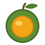

# Rensga Engine — Visual identity

<!-- Generated by roadmaps/src/build_brand.py from data_brand.py. Do not edit; edit the data and rebuild. -->

Rensga's look comes from one object: the pequi, a fruit of the cerrado in Goiás, Brazil, with a green husk around bright golden pulp. The palette takes its main colors straight from the icon, adds warm neutrals to set them on, and borrows a few more cerrado colors for status messages and console targets.

## Principles

1. **Gold is the signal.** Pequi gold marks the one thing to look at: the Play button, the selection, the primary action. Most of a screen is warm neutral.
2. **Green is the frame.** Cerrado green carries links, section headers and success.
3. **Warm, not grey.** Neutrals are tinted toward soil so gold and green sit naturally on them.
4. **Gold is a fill on light backgrounds.** Gold text on white is only 2.1:1. Put dark ink text on a gold fill instead. On dark backgrounds gold text is fine.
5. **Status is never color alone.** Pair every status color with an icon or a word.
6. **Contrast is checked at build time.** Like a scene over budget, a token pair under its contrast minimum stops build_brand.py with an error that names the pair.

## Logo

Drawn on a 64x64 grid: husk circle r23 at (32, 37), pulp circle r15 at (32, 38), stem and leaf at the top right.

Keep clear space of at least a quarter of the icon's width on every side.

Icon on the left, wordmark on the right. Icon height is 2.2x the wordmark font size; the gap is 0.3x the icon height. The wordmark is "Rensga Engine" in the UI font at weight 600, in the text color. The docs header uses 40 px, 18 px and 12 px.

| Variant | File | Use |
| --- | --- | --- |
| Full color | `rensga-icon.svg` | Default, on light or dark soil backgrounds |
| One color, dark | `brand/rensga-icon-mono-dark.svg` | One-ink printing, engraving, light photos |
| One color, light | `brand/rensga-icon-mono-light.svg` | Dark photos and solid dark or colored backgrounds |

**Icon colors**

| Part | Palette | Hex |
| --- | --- | --- |
| Stem | `bark.700` | `#5a4326` |
| Leaf | `cerrado.600` | `#4f7d2a` |
| Husk | `cerrado.500` | `#5f8f34` |
| Husk rim | `cerrado.700` | `#3f6420` |
| Pulp | `pequi.500` | `#f2a516` |
| Pulp rim | `pequi.600` | `#d98a0b` |
| Highlight | `pequi.300` | `#ffd66b` |

| Size | Use |
| --- | --- |
| 16 px | smallest use: favicon |
| 24 px | editor toolbar and tabs |
| 40 px | docs page header |
| 128 px and up | splash screen, release pages |

**Do**

- Use the full-color icon on soil backgrounds, light or dark.
- Use a one-color version when only one ink is available or the background is busy.
- Scale it proportionally and keep its clear space.

**Don't**

- Recolor its parts, or swap the gold for another hue.
- Stretch, rotate, outline it, or add shadows or gradients.
- Place the full-color icon on mid-green or gold backgrounds, where the husk or pulp disappears.
- Combine it with Sony marks: the PlayStation logo, its four colors, or the controller face-button shapes.

## Palette

Steps marked with an icon part come straight from the icon.

### Pequi gold (`pequi`)

From the pulp. Primary actions, Play, selection, focus, highlights, warnings.

| Step | Hex | In the icon |
| --- | --- | --- |
| `pequi.50` | `#fff8e6` |  |
| `pequi.100` | `#ffefc2` |  |
| `pequi.200` | `#ffe08a` |  |
| `pequi.300` | `#ffd66b` | Highlight |
| `pequi.400` | `#f7bc3a` |  |
| `pequi.500` | `#f2a516` | Pulp |
| `pequi.600` | `#d98a0b` | Pulp rim |
| `pequi.700` | `#b06d08` |  |
| `pequi.800` | `#85510a` |  |
| `pequi.900` | `#5c380b` |  |

### Cerrado green (`cerrado`)

From the husk and the leaf. Links, section headers, success, foliage in art.

| Step | Hex | In the icon |
| --- | --- | --- |
| `cerrado.50` | `#f1f6ea` |  |
| `cerrado.100` | `#e6f0da` |  |
| `cerrado.200` | `#c2dba6` |  |
| `cerrado.300` | `#9fc477` |  |
| `cerrado.400` | `#7eaa50` |  |
| `cerrado.500` | `#5f8f34` | Husk |
| `cerrado.600` | `#4f7d2a` | Leaf |
| `cerrado.700` | `#3f6420` | Husk rim |
| `cerrado.800` | `#2f4b18` |  |
| `cerrado.900` | `#1f3210` |  |

### Soil (`soil`)

From warm neutrals. Backgrounds, surfaces, borders, text.

| Step | Hex | In the icon |
| --- | --- | --- |
| `soil.50` | `#faf8f3` |  |
| `soil.100` | `#f2efe6` |  |
| `soil.200` | `#e4dfd2` |  |
| `soil.300` | `#cdc6b5` |  |
| `soil.400` | `#a59d8a` |  |
| `soil.500` | `#736b5a` |  |
| `soil.600` | `#5c5547` |  |
| `soil.700` | `#403b31` |  |
| `soil.800` | `#2b2822` |  |
| `soil.900` | `#1c1a16` |  |

### Bark (`bark`)

From the stem. Rare accent for wood and earth in art and illustrations; not for UI state.

| Step | Hex | In the icon |
| --- | --- | --- |
| `bark.300` | `#b59a73` |  |
| `bark.500` | `#7a5c36` |  |
| `bark.700` | `#5a4326` | Stem |
| `bark.900` | `#2e2214` |  |

### Urucum red (`urucum`)

From annatto, the red seed dye of Brazil. Errors, Stop, over-budget.

| Step | Hex | In the icon |
| --- | --- | --- |
| `urucum.100` | `#fde8e4` |  |
| `urucum.300` | `#f7b4aa` |  |
| `urucum.700` | `#a3261c` |  |
| `urucum.900` | `#5a1a14` |  |

### Cerrado sky (`ceu`)

From the dry-season sky. Information and neutral notices.

| Step | Hex | In the icon |
| --- | --- | --- |
| `ceu.100` | `#e3eef8` |  |
| `ceu.300` | `#a9cdee` |  |
| `ceu.700` | `#245a8a` |  |
| `ceu.900` | `#173a5c` |  |

## Design tokens

UI code uses these names, never raw palette steps. In CSS they are `--rg-<name>` in `brand/rensga-tokens.css`.

| Token | Light | Dark | Use |
| --- | --- | --- | --- |
| `bg` | `#faf8f3` (soil.50) | `#1c1a16` (soil.900) | Page and editor window background |
| `surface` | `#ffffff` (#ffffff) | `#2b2822` (soil.800) | Cards, panels, inspector rows, inputs |
| `surface-2` | `#f2efe6` (soil.100) | `#23211c` (#23211c) | Inset areas, code blocks, table headers |
| `border` | `#e4dfd2` (soil.200) | `#403b31` (soil.700) | Dividers and outlines |
| `border-strong` | `#cdc6b5` (soil.300) | `#5c5547` (soil.600) | Hovered outlines, input borders |
| `text` | `#1c1a16` (soil.900) | `#faf8f3` (soil.50) | Body text and icons |
| `text-2` | `#5c5547` (soil.600) | `#cdc6b5` (soil.300) | Secondary text |
| `muted` | `#736b5a` (soil.500) | `#a59d8a` (soil.400) | Captions, hints, placeholders |
| `link` | `#3f6420` (cerrado.700) | `#9fc477` (cerrado.300) | Links and text buttons |
| `primary` | `#f2a516` (pequi.500) | `#f2a516` (pequi.500) | Primary button, Play, selection fill |
| `primary-hover` | `#f7bc3a` (pequi.400) | `#f7bc3a` (pequi.400) | Hovered primary button |
| `on-primary` | `#1c1a16` (soil.900) | `#1c1a16` (soil.900) | Text and icons on primary |
| `focus` | `#b06d08` (pequi.700) | `#f2a516` (pequi.500) | Keyboard focus ring (2 px) |
| `ok` | `#2f4b18` (cerrado.800) | `#c2dba6` (cerrado.200) | Success text and icons |
| `ok-bg` | `#e6f0da` (cerrado.100) | `#1f3210` (cerrado.900) | Success background |
| `warn` | `#85510a` (pequi.800) | `#ffd66b` (pequi.300) | Warning text and icons, near-budget |
| `warn-bg` | `#fff8e6` (pequi.50) | `#5c380b` (pequi.900) | Warning background |
| `danger` | `#a3261c` (urucum.700) | `#f7b4aa` (urucum.300) | Error text and icons, over-budget, Stop |
| `danger-bg` | `#fde8e4` (urucum.100) | `#5a1a14` (urucum.900) | Error background |
| `info` | `#245a8a` (ceu.700) | `#a9cdee` (ceu.300) | Information text and icons |
| `info-bg` | `#e3eef8` (ceu.100) | `#173a5c` (ceu.900) | Information background |

### Contrast checks

Computed by the build (WCAG 2 ratio). The build fails if any row is under its minimum.

| Theme | Text | On | Ratio | Minimum |
| --- | --- | --- | --- | --- |
| light | `text` | `bg` | 16.37:1 | 4.5:1 |
| light | `text` | `surface` | 17.37:1 | 4.5:1 |
| light | `text` | `surface-2` | 15.11:1 | 4.5:1 |
| light | `text-2` | `bg` | 6.95:1 | 4.5:1 |
| light | `text-2` | `surface` | 7.38:1 | 4.5:1 |
| light | `muted` | `bg` | 4.97:1 | 4.5:1 |
| light | `muted` | `surface` | 5.28:1 | 4.5:1 |
| light | `link` | `bg` | 6.48:1 | 4.5:1 |
| light | `link` | `surface` | 6.87:1 | 4.5:1 |
| light | `on-primary` | `primary` | 8.41:1 | 4.5:1 |
| light | `on-primary` | `primary-hover` | 10.10:1 | 4.5:1 |
| light | `focus` | `bg` | 3.93:1 | 3.0:1 |
| light | `focus` | `surface` | 4.17:1 | 3.0:1 |
| light | `ok` | `ok-bg` | 8.34:1 | 4.5:1 |
| light | `warn` | `warn-bg` | 6.24:1 | 4.5:1 |
| light | `danger` | `danger-bg` | 6.26:1 | 4.5:1 |
| light | `info` | `info-bg` | 6.15:1 | 4.5:1 |
| dark | `text` | `bg` | 16.37:1 | 4.5:1 |
| dark | `text` | `surface` | 13.84:1 | 4.5:1 |
| dark | `text` | `surface-2` | 15.15:1 | 4.5:1 |
| dark | `text-2` | `bg` | 10.21:1 | 4.5:1 |
| dark | `text-2` | `surface` | 8.63:1 | 4.5:1 |
| dark | `muted` | `bg` | 6.44:1 | 4.5:1 |
| dark | `muted` | `surface` | 5.45:1 | 4.5:1 |
| dark | `link` | `bg` | 8.80:1 | 4.5:1 |
| dark | `link` | `surface` | 7.44:1 | 4.5:1 |
| dark | `on-primary` | `primary` | 8.41:1 | 4.5:1 |
| dark | `on-primary` | `primary-hover` | 10.10:1 | 4.5:1 |
| dark | `focus` | `bg` | 8.41:1 | 3.0:1 |
| dark | `focus` | `surface` | 7.11:1 | 3.0:1 |
| dark | `ok` | `ok-bg` | 9.18:1 | 4.5:1 |
| dark | `warn` | `warn-bg` | 7.45:1 | 4.5:1 |
| dark | `danger` | `danger-bg` | 7.57:1 | 4.5:1 |
| dark | `info` | `info-bg` | 7.04:1 | 4.5:1 |
| both | `white` | `target PSX` | 6.70:1 | 4.5:1 |
| both | `white` | `target PSP` | 5.88:1 | 4.5:1 |
| both | `white` | `target PS2` | 5.58:1 | 4.5:1 |
| both | `white` | `target Windows · Linux · Android` | 7.38:1 | 4.5:1 |
| editor | `text` | `WindowBg` | 16.37:1 | 4.5:1 |
| editor | `text` | `ChildBg` | 15.15:1 | 4.5:1 |
| editor | `text` | `PopupBg` | 13.84:1 | 4.5:1 |
| editor | `text` | `FrameBg` | 13.84:1 | 4.5:1 |
| editor | `text` | `FrameBgHovered` | 10.48:1 | 4.5:1 |
| editor | `text` | `FrameBgActive` | 6.95:1 | 4.5:1 |
| editor | `text` | `TitleBg` | 16.37:1 | 4.5:1 |
| editor | `text` | `TitleBgActive` | 13.84:1 | 4.5:1 |
| editor | `text` | `Button` | 10.48:1 | 4.5:1 |
| editor | `text` | `ButtonHovered` | 6.95:1 | 4.5:1 |
| editor | `text` | `ButtonActive` | 6.22:1 | 4.5:1 |
| editor | `text` | `Header` | 9.24:1 | 4.5:1 |
| editor | `text` | `HeaderHovered` | 6.48:1 | 4.5:1 |
| editor | `text` | `Tab` | 15.15:1 | 4.5:1 |
| editor | `text` | `TabHovered` | 10.48:1 | 4.5:1 |
| editor | `text` | `TextSelectedBg` | 6.81:1 | 4.5:1 |
| editor | `text` | `MenuBarBg` | 15.15:1 | 4.5:1 |
| editor | `text` | `TitleBgCollapsed` | 15.15:1 | 4.5:1 |
| editor | `text` | `TableHeaderBg` | 15.15:1 | 4.5:1 |
| editor | `text` | `TabSelected` | 13.84:1 | 4.5:1 |
| editor | `text` | `TabDimmed` | 15.15:1 | 4.5:1 |
| editor | `text` | `TabDimmedSelected` | 13.84:1 | 4.5:1 |

## Console targets

Tags that name a target in Build Settings, the ConsoleTarget inspector, the project list and the docs. They identify a target; they are not status colors. White text on all of them.

| Target | Hex | Name | From |
| --- | --- | --- | --- |
| PSX | `#6e4a9e` | Ipê roxo | the purple ipê tree |
| PSP | `#1d6f73` | Vereda | the teal water of the cerrado's palm wetlands |
| PS2 | `#b23c6e` | Ipê rosa | the pink ipê tree |
| Windows · Linux · Android | `#5c5547` | Soil 600 | the neutral ramp |

## Typography

Docs pages use system fonts so they work offline with nothing to download. UI: `system-ui, -apple-system, "Segoe UI", Roboto, sans-serif`. Mono: `ui-monospace, Menlo, Consolas, monospace`.

Proposed for the editor: Inter for UI text and JetBrains Mono for code and the Console, both SIL OFL 1.1, bundled as TTF files because Dear ImGui loads fonts from disk.

| Style | Size | Weight |
| --- | --- | --- |
| Page title | 24 px | 600 |
| Section heading | 18 px | 600 |
| Body | 15 px | 400 |
| Small | 13 px | 400 |
| Caption | 12.5 px | 400 |
| Label (mono) | 11.5 px | 400 |

## Editor theme

Dear ImGui colors for the dark theme. Rows marked "text" carry text and are contrast-checked.

| ImGuiCol_ | Hex | From |  |
| --- | --- | --- | --- |
| `WindowBg` | `#1c1a16` | `bg` | text |
| `ChildBg` | `#23211c` | `surface-2` | text |
| `PopupBg` | `#2b2822` | `surface` | text |
| `Border` | `#403b31` | `border` |  |
| `FrameBg` | `#2b2822` | `surface` | text |
| `FrameBgHovered` | `#403b31` | `soil.700` | text |
| `FrameBgActive` | `#5c5547` | `soil.600` | text |
| `TitleBg` | `#1c1a16` | `soil.900` | text |
| `TitleBgActive` | `#2b2822` | `soil.800` | text |
| `Text` | `#faf8f3` | `text` |  |
| `TextDisabled` | `#a59d8a` | `muted` |  |
| `Button` | `#403b31` | `soil.700` | text |
| `ButtonHovered` | `#5c5547` | `soil.600` | text |
| `ButtonActive` | `#85510a` | `pequi.800` | text |
| `Header` | `#2f4b18` | `cerrado.800` | text |
| `HeaderHovered` | `#3f6420` | `cerrado.700` | text |
| `HeaderActive` | `#4f7d2a` | `cerrado.600` |  |
| `CheckMark` | `#f2a516` | `primary` |  |
| `SliderGrab` | `#d98a0b` | `pequi.600` |  |
| `SliderGrabActive` | `#f2a516` | `primary` |  |
| `Tab` | `#23211c` | `surface-2` | text |
| `TabHovered` | `#403b31` | `soil.700` | text |
| `PlotHistogram` | `#f2a516` | `primary` |  |
| `DockingPreview` | `#f2a516` | `primary` |  |
| `TextSelectedBg` | `#245a8a` | `ceu.700` | text |
| `MenuBarBg` | `#23211c` | `surface-2` | text |
| `TitleBgCollapsed` | `#23211c` | `surface-2` | text |
| `TableHeaderBg` | `#23211c` | `surface-2` | text |
| `ScrollbarBg` | `#1c1a16` | `bg` |  |
| `ScrollbarGrab` | `#403b31` | `soil.700` |  |
| `ScrollbarGrabHovered` | `#5c5547` | `soil.600` |  |
| `ScrollbarGrabActive` | `#736b5a` | `soil.500` |  |
| `Separator` | `#403b31` | `border` |  |
| `SeparatorHovered` | `#d98a0b` | `pequi.600` |  |
| `SeparatorActive` | `#f2a516` | `primary` |  |
| `ResizeGrip` | `#403b31` | `soil.700` |  |
| `ResizeGripHovered` | `#5c5547` | `soil.600` |  |
| `ResizeGripActive` | `#f2a516` | `primary` |  |
| `TabSelected` | `#2b2822` | `soil.800` | text |
| `TabSelectedOverline` | `#f2a516` | `primary` |  |
| `TabDimmed` | `#23211c` | `surface-2` | text |
| `TabDimmedSelected` | `#2b2822` | `soil.800` | text |
| `TabDimmedSelectedOverline` | `#5c5547` | `soil.600` |  |
| `TableBorderStrong` | `#403b31` | `border` |  |
| `TableBorderLight` | `#403b31` | `border` |  |
| `NavCursor` | `#f2a516` | `focus` |  |
| `DragDropTarget` | `#f2a516` | `primary` |  |
| `TextLink` | `#9fc477` | `link` |  |
| `PlotLines` | `#9fc477` | `link` |  |
| `DockingEmptyBg` | `#1c1a16` | `bg` |  |
| `ModalWindowDimBg` | `#1c1a16` | `bg` |  |
| `NavWindowingDimBg` | `#1c1a16` | `bg` |  |
| `NavWindowingHighlight` | `#faf8f3` | `text` |  |

- The editor defaults to the dark theme. A light theme uses the same mapping with the light token values.
- The Play button is primary (gold with dark ink). Stop uses danger. Only one gold button is visible at a time.
- Budget bars: under 80% uses ok, 80 to 100% uses warn, over 100% uses danger with the asset named. The build fails over 100% anyway.
- DockingPreview and TextSelectedBg are drawn at about 40% opacity.

## Imagery

- Show game screenshots at the target's native resolution, scaled by whole numbers with nearest-neighbor filtering (PSX 320x240, PSP 480x272, PS2 640x448).
- Label every screenshot with its target and whether it came from an emulator or real hardware.
- Prefer the template projects' primitive characters and test levels for docs art, so images match what users will see.
- In diagrams, draw boxes and lines in soil, use gold for the one path the diagram is about, green for data, and target colors for per-console boxes.

## Name and voice

- Write "Rensga Engine" on first mention, then "Rensga".
- Plain sentences, in the same tone as the design document.
- Say a build "runs on PSP". Never suggest that Sony made or endorses Rensga.
