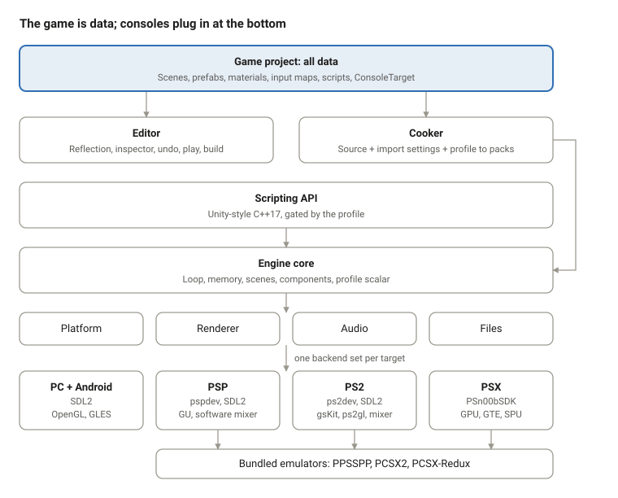
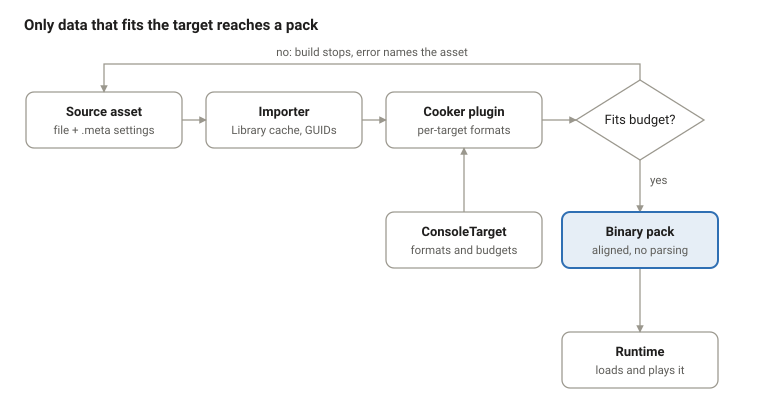

# Rensga Engine — Design Document

As of 2026-10-29 · Breno Freitas Aguirres

## Overview

Rensga Engine is one open-source, MIT-licensed program that lets someone who knows Unity build a game once and ship it as a PSX disc image, a PSP EBOOT or a PS2 ISO, plus native Windows, Linux and Android builds of the same game.

It has three parts that ship together: a C++17 runtime engine, a Unity-style editor, and a Unity-style C++ scripting API. Each console plugs in as a target module, and each project picks one console profile (a ConsoleTarget asset) when it is created. The editor bundles PCSX-Redux, PPSSPP and PCSX2 so the Play button runs the game on the emulated console.

The guiding idea is that a game is data. Scenes, prefabs, materials, input maps, animation graphs, budgets and console profiles are all assets the editor edits and the runtime plays; code only defines behaviour and the systems that consume that data.

Intended users: hobbyists and small teams making new games for these consoles, retro-style indie developers who also want PC and Android releases, and students learning console-era constraints.

**Name and icon.** The software is called Rensga Engine. Its icon is a pequi fruit, from the cerrado of Goiás, Brazil.

## Goals and non-goals

The engine succeeds when a Unity user can create a project from a template, assemble a scene, write a script and press Play to see it running in the right emulator, without touching a console SDK.

**Goals**

1. One editor, one API and one runtime for PSX, PSP and PS2, with Windows, Linux and Android builds of every game.
2. A Unity-like workflow: GameObjects, components, prefabs, inspector, play mode, build settings.
3. Console limits enforced as data at cook time, so a game that builds also fits.
4. Identical gameplay across a console build and its PC and Android builds.
5. Adding a console means writing a target module, never changing editor core.
6. Fully open source, with the three emulators and every console toolchain installable from the Hub as modules, so nobody needs Docker.

**Non-goals**

- Running C# or .NET. Scripts are C++17.
- Modern rendering features the consoles cannot run: shader graphs, per-pixel lighting, URP/HDRP, DOTS.
- Commercial store integration, licensing servers or paid tiers.
- Shipping a PS2 BIOS. Users supply their own for PCSX2.
- An editor that runs on Android or on the consoles themselves.

## Data-driven philosophy

Every decision in this engine follows one rule: if it describes the game or the target, it is data; code exists only to define behaviour and to turn data into running frames. The principles below apply to the engine, the editor and the API alike, and a design that breaks one of them needs a written reason.

1. **The game is data, the engine is a player.** Scenes, prefabs, materials, input actions, animation clips, Animator graphs, UI canvases and build settings are assets. The runtime loads and plays them; it never contains a specific game's content.
2. **Targets differ by data, not by code paths.** The ConsoleTarget asset (profile, scalar type, resolution, budgets, texture formats, depth mode, media, allowed components) is the only place a console's rules live. Game code never branches on a console; engine code reads the profile instead of scattering `#ifdef`s.
3. **One source, many cooked forms.** Artists and designers edit one source asset. The cooker turns it into each target's format (CLUT textures, swizzled textures, fixed-point meshes, VAG audio) as a pure function of source plus import settings plus ConsoleTarget.
4. **Reflection is the single description of every type.** Component fields are declared once, with macros, and a code generator produces the type info. The inspector, JSON serialization, prefab overrides, undo, hot reload and the binary cooker all read that one description, so they cannot disagree.
5. **Budgets are data, checked before runtime.** Memory, VRAM, SPU RAM, polygon and voice budgets live in the ConsoleTarget. The cooker and the build validator refuse a scene that does not fit, with a message that names the asset; nothing is discovered as a crash on the console.
6. **Text for people, binary for machines.** In the editor, scenes, prefabs and meta files are diff-friendly JSON for version control. At build time they become packed binary that the runtime loads with no parsing, aligned for DMA and CD sectors.
7. **Data-oriented layout at runtime.** Components live in fixed-capacity, contiguous arrays sized from the scene data, with no per-frame allocation. This is what lets the same core run in the PSX's 2 MB.
8. **Behaviour is configured, not rewritten.** Exposed script fields, data assets (the equivalent of ScriptableObjects), serialized events and Animator parameters let designers change how a game behaves without recompiling.
9. **Determinism is part of the data contract.** The same scene data and inputs give the same result on a console and on its PC and Android builds; the PSX profile uses fixed-point everywhere, including its PC builds.
10. **References are by GUID.** Assets and objects refer to each other by stable IDs, never by path or pointer, so renames, moves and hot reloads never break a link.

## Architecture

The software is layered so that data flows down and console specifics stay at the bottom: game data at the top, the editor and cooker that edit and transform it, the API and core that play it, and one set of backends per target.



The cooker's packs feed the engine core; each console's backends implement the same four interfaces, and the editor reaches consoles only through their TargetModules.

```
engine/
  core/          target-agnostic: memory, scenes, components, loop, mixer
  api/           public Unity-style API, profile-gated
  profiles/      psx/ psp/ ps2/ (ConsoleTarget definitions, feature gates, budgets)
  backends/
    render/      gl/  gu/  gs/  gpu/
    platform/    sdl/  psp/  ps2/  psx/
    audio/       software/  spu/
editor/
  core/          panels, reflection, undo, asset database, play, build
  targets/       psp/ ps2/ psx/ (TargetModules)
tools/cooker/    shared, with per-target format plugins
templates/       psp-2d/ psp-3d/ ps2-2d/ (ps2-3d, psx-2d, psx-3d arrive with their phases)
third_party/emulators/  ppsspp/ pcsx2/ pcsx-redux/ (pinned, with licenses)
```

**Dependency rules.**

- `core` depends on nothing console-specific; it sees backends only through interfaces.
- `api` depends on `core` and `profiles`, never on a backend.
- `editor/core` never names a console; everything console-specific lives in `editor/targets`.
- Game projects depend only on `api`.
- The cooker shares the reflection and asset code with the editor, so both read data the same way.

## Data model

Everything a project contains is an asset with a GUID, and everything an asset references is another GUID. The table lists the asset kinds and where each is specified in the roadmaps.

| Asset | What it holds | Editor format | Runtime form | Roadmap |
| --- | --- | --- | --- | --- |
| ConsoleTarget | Profile, scalar type, resolution, budgets, texture formats, depth mode, media, allowed components | JSON | Compiled into the build as constants | Engine 1; PSX/PSP/PS2 API 0 |
| Scene | GameObject hierarchy, components, field values, prefab instances with overrides | JSON | Binary pack, fixed-capacity component arrays | Editor 1–2; API 2 |
| Prefab / variant | A reusable GameObject tree; a variant = base GUID + overrides | JSON | Merged at cook time | Editor 6 |
| Data asset | Designer-editable data for scripts (ScriptableObject equivalent) | JSON | Binary record | Editor 13 |
| Texture, model, audio | Source file + `.meta` with GUID and per-target import settings | Source + JSON meta | Cooked per target | Editor 3; per-console engine cooker phases |
| Material | Texture, color, blend mode, fog, profile-gated options | JSON | Binary record | Editor 8; per-console API rendering phases |
| Input actions | Named actions mapped to the virtual gamepad per profile | JSON | Binary table | Editor 10; API 5 |
| Animation clip / Animator | Keyframes on reflected fields; state graph with parameters | JSON | Binary curves and graph | Editor 9; API 8 |
| UI canvas | RectTransform tree, images, text, buttons | Part of a scene | Part of the scene pack | Editor 10; API 10 |
| Build settings | Scenes in build, target, development flag | JSON | Not shipped | Editor 11 |

**GameObjects and components.** A GameObject owns a Transform and a list of components. Components are plain reflected structs; behaviour scripts derive from `Behaviour`. At runtime, components of one type sit in one contiguous array.

**Prefab overrides.** An instance stores its prefab GUID plus a list of overrides: object ID, field path, value. Loading applies the prefab, then the overrides, so editing a prefab updates every instance except overridden fields.

**Reflection.** Fields are declared with `SERIALIZE_FIELD`, `RANGE`, `HEADER` and similar macros. A header scanner generates type info at build time; runtime builds strip editor-only metadata to save memory.

**Meta files.** Each source file has a `.meta` with its GUID and import settings per target, so moving or renaming files never breaks a reference.

## Asset pipeline

Cooking is a pure function of source asset, import settings and ConsoleTarget, and the budget check runs before anything reaches a console.



- **Import.** A file dropped into Assets gets a `.meta` with its GUID and per-target import settings; the importer writes a normalized copy to the Library cache, which is never committed. (Editor 3)
- **Cook.** Each target's format plugin converts Library data: CLUT and swizzled textures for PSP and PS2, 4/8/15-bit textures with an offline VRAM packer for PSX, fixed-point meshes, VAG audio. Only changed assets are recooked. (Engine 3; PSP Engine 3; PSX Engine 4)
- **Validate.** Scene totals are checked against the ConsoleTarget's memory, VRAM, SPU RAM, polygon and voice budgets; a scene that does not fit stops the build with an error naming the asset. (Editor 11; PSP Editor 4; PSX Editor 4)
- **Pack.** Cooked data is written into binary packs aligned for DMA and 2048-byte CD sectors, with a table of contents and a version. (Engine 3)
- **Load.** The runtime maps packs straight into its fixed-capacity arrays with no parsing. During Play, the game reads cooked assets from the project folder instead of a disc image. (Emulator Play 2)

## Runtime

One core, compiled per profile, runs every game; console differences are pushed down into backends behind four interfaces: platform, renderer, audio and file system.

**Main loop.** Fixed timestep with interpolated rendering, NTSC 60 Hz and PAL 50 Hz aware. Lifecycle order matches Unity: Awake, OnEnable, Start, FixedUpdate, Update, LateUpdate, OnDisable, OnDestroy. (Engine 1; API 3)

**Memory.** Arena, pool and frame allocators sized from the ConsoleTarget budget. No heap allocation per frame, 16-byte alignment for DMA. Runtime builds strip reflection metadata and any module the profile does not use. (Engine 1; PSX Engine 2)

**Scalar type.** All math in the core goes through the profile's scalar: `float` on PSP, PS2 and PC profiles, 20.12 fixed-point on PSX. The PC and Android builds of a PSX game use fixed-point too, for identical results. (PSX Engine 1; PSX API 1)

**Renderer interface.** High-level calls (draw this mesh with this material, this sprite batch) that carry a sort key as well as depth. Backends: `gl` for PC and Android (OpenGL 3.3 / GLES 3.0), `gu` for PSP, `gs` for PS2 (gsKit for 2D, ps2gl on VU1 for 3D), `gpu` for PSX (ordering tables and the GTE). (Engine 2 and 7; PSP Engine 2 and 6; PSX Engine 3 and 7)

**Audio backends.** An AudioBackend interface with two kinds: a software mixer on SDL audio (PC, Android, PSP, PS2) and hardware voices (SPU on PSX, optionally SPU2 on PS2). Music streams from disc on every target; on PSX it plays XA tracks. (Engine 4; PSX Engine 5)

**Scenes and streaming.** Scenes load from packs; additive loading becomes area streaming on PSX, where a whole level rarely fits in 2 MB. (Engine 5; PSX Engine 8; API 9)

**Platform layer.** SDL2 on PC, Android, PSP and PS2; a custom layer on PSn00bSDK for PSX, which has no SDL port. Input maps to one virtual gamepad. (Engine 1; PSP Engine 1; PSX Engine 2)

## Targets and profiles

A project has exactly one profile (PSX, PSP or PS2) and always builds for that console plus Windows, Linux and Android. The profile is chosen from a template when the project is created and is stored in its ConsoleTarget asset.

| | PSX | PSP | PS2 |
| --- | --- | --- | --- |
| Scalar | 20.12 fixed-point | float | float |
| RAM / VRAM | 2 MB / 1 MB | 32 MB budget (64 MB on slim) / 2 MB | 32 MB / 4 MB |
| Native resolution | 320x240 | 480x272 | 640x448 |
| Depth | Ordering tables (sort keys) | Z-buffer | Z-buffer |
| Lights per object | 3 (GTE) | 4 (hardware) | per ps2gl |
| Characters | Segmented rigid models | Hardware skinning, 8 bones per draw | CPU skinning |
| Audio backend | SPU hardware voices, XA music | Software mixer | Software mixer |
| SDK / platform | PSn00bSDK, custom layer | pspdev + SDL2 | ps2dev + SDL2 |
| Output | BIN/CUE | EBOOT.PBP | ISO |
| Bundled emulator | PCSX-Redux (OpenBIOS) | PPSSPP (no BIOS needed) | PCSX2 (user BIOS) |

**TargetModule interface.** Each console registers one module with the editor that supplies its importers, cooker format plugin, preview rules, inspector gating rules, validator, packager and emulator launcher. Editor core never names a console; if a console needs something the interface lacks, the interface grows. (PSP Editor 0; PSX Editor 0)

**Profile gating.** A feature the profile lacks is hidden or greyed in the inspector with a reason, rejected by the validator, and a compile error with a hint in scripts. (PSP API 0; PSX API 0)

**PC enhancements.** PC and Android builds render at the native resolution scaled up by default. Optional enhancements (higher resolution, perspective-correct textures on PSX) are project settings, off by default.

## Editor

The editor is a data editor: every panel views or changes assets through reflection and the undo stack, and it runs on Windows and Linux using Dear ImGui (docking) on SDL2 and OpenGL.

**Panels.** Hierarchy, Scene view with ImGuizmo handles, Game view, Inspector built from reflection, Project window over the asset database, Console, VRAM map, Animation window, Animator graph (imnodes), Profiler, Build Settings, Project Settings, the emulator manager and Hub > Modules. (Editor 0–13 and 11.5; PSX Editor 2)

**Two ways to play.** The Play dropdown chooses between Play in editor (a PC preview through the profile's preview shader, with live budget bars) and Play on console (a development build running in the bundled emulator). Stop reverts play-mode changes in the editor preview. (Editor 5; Emulator Play roadmap; PSP Editor 3; PSX Editor 3)

**Scripting workflow.** Create › C++ Script makes a `Behaviour` from a template. Game code is a separate library that the editor rebuilds and hot-reloads on save by serializing script state, swapping the library and restoring state. Release builds link the same code statically. (Editor 4)

**Build pipeline.** Validate budgets, cook for the target, compile with the target's native toolchain module, package (BIN/CUE, EBOOT.PBP, ISO, exe, AppImage, APK), then optionally launch. If the target's build support module is missing, Play and Build offer to install it (Editor 11.5). Play skips packaging and boots the executable directly with assets read from the project folder. (Editor 11; Emulator Play 2)

**Hub and modules.** The project hub (like Unity Hub) lists projects and has a Modules tab. Each console or cross target is a build support module the user installs per user, with progress, a cancel button and a license prompt before anything that has a license (Google's Android SDK). Missing modules are named in the target's validation message with the install command. No module needs Docker. (Editor 0 and 11.5)

**Templates.** Every target API has a 2D and a 3D template, shown as two cards per target in the Hub's Create Project screen. A 3D template has its ConsoleTarget, a primitive character, a primitive test level and a shared third-person controller script that compiles for both float and fixed-point profiles. A 2D template is one tilemap room at the target's resolution (PSP 480x272, PS2 640x448, PSX 320x240 with CLUT4 tiles), a sprite player driven by a shared 2D platformer controller written against `Scalar`, a coin, a HUD and Camera2D. Templates that are not built yet are greyed out and name the phase that brings them. Folders are `templates/<api>-2d` and `templates/<api>-3d`. The PSP 2D template and the picker come first (PSP Template 5), then PS2 (PS2 Template 5) and PSX (PSX Template 5, after PSX Engine 6). CI cooks every template and boots it in its emulator: PPSSPP headless, PCSX-Redux with OpenBIOS, and PCSX2 locally because it needs a BIOS dump. (PSX, PSP and PS2 Template roadmaps)

**Extensibility.** Projects add custom inspectors, editor windows and menu items in C++, registered by macro and hot-reloaded with game code. (Editor 13)

## Scripting API

The API is one Unity-style C++17 surface for every profile: the same class and method names everywhere, with features gated by the project's profile.

```cpp
class PlayerController : public Behaviour {
    REFLECT(PlayerController)
    SERIALIZE_FIELD(Scalar, speed, 5) RANGE(0, 20)
    Ref<CharacterController> cc;

    void Start() override { cc = GetComponent<CharacterController>(); }
    void Update() override {
        Vector3 move(Input::GetAxis("Horizontal"), 0, Input::GetAxis("Vertical"));
        cc->Move(move * speed * Time::deltaTime());
    }
};
```

**Design rules.** Unity names are kept (`GetComponent`, `Instantiate`, `Destroy`, `Raycast`, `StartCoroutine`). C++ has no properties, so properties become getters and setters. No exceptions, no per-frame allocation. The full rule set is in [api-rules.md](../api-rules.md). (API 0)

**Ref handles.** Scripts hold `Ref<T>`, a generational handle that reads as null after `Destroy`, like Unity's fake null, so scripts never touch a dangling pointer. (API 0 and 2)

**Scalar.** Scripts use the `Scalar` type and the math classes; on PSX they are fixed-point and using `float` in game code is a compile error with a hint. (PSX API 0–1)

**Data hooks.** Attribute macros (`SERIALIZE_FIELD`, `RANGE`, `HEADER`, `TOOLTIP`, `REQUIRE_COMPONENT`) put script fields in the inspector, and serialized events bind script methods to other objects in the editor, so behaviour is tuned as data. (API 4 and 11)

**Coverage.** Math, object model, lifecycle, time, coroutines, input, physics, rendering, animation, audio, scenes, saves, UI, platform and profiling, with per-profile additions: PSP system services and optional ad hoc play; PSX segmented meshes, XA music, memory card saves and optional FMV. (API 1–13; PSP API; PSX API)

## Toolchains, emulators and testing

Users never need Docker. Every console and cross build uses a build support module: a pinned, sha256-verified, prebuilt native toolchain archive for the user's host (Linux x86_64 or Windows x86_64, the two hosts the editor runs on). Modules are installed per user from Hub > Modules or with `rensga modules install <id>`, into a modules folder under the user's data directory. Emulators are modules too, or system installs the user points the editor at. CI installs the same modules, so what we test is what users get.

| Target | Native toolchain module (hosts) | Emulator | BIOS | Automated boot test |
| --- | --- | --- | --- | --- |
| PSX | `psx-build`: PSn00bSDK + mipsel GCC, mkpsxiso (Linux, Windows) | PCSX-Redux | OpenBIOS | Public CI |
| PSP | `psp-build`: pspdev, psp-gcc, SDL2 (Linux from upstream releases; Windows built by our CI, shown as unpublished until released) | PPSSPP | None needed | Public CI, headless |
| PS2 | `ps2-build`: ps2dev, EE GCC, PS2SDK, gsKit, ps2gl, SDL2 (Linux, Windows); the ISO is written by our own tool | PCSX2 | User's own dump | Self-hosted runner with a maintainer's private dump |
| Windows | `windows-build`: llvm-mingw (ucrt) + SDL2 (Linux, Windows) | None (Wine in CI) | None | Public CI |
| Android | `android-build`: Temurin JDK 17, Android command-line tools, Gradle, then NDK, platform and build-tools via `sdkmanager` | None | None | Public CI (built; device runs are local) |
| Linux | Host compiler plus `build-tools` (portable CMake and Ninja) when the host lacks them | None | None | Public CI |

**Module catalog.** One JSON file per module in `tools/modules/manifest.d/`: id, version, kind (toolchain, emulator or tools), target, dependencies, license, source link, notice, per-host URL, sha256, size, archive type and status, environment variables and a check command. Status is `available`, `unpublished` (we build it in our own CI but have not released it yet; the Hub says so plainly) or `manual` (the user installs it and points the editor at it). (Editor 11.5)

**Install.** Download with curl into a cache (resumable), verify sha256, extract into a temporary folder, rename into place, then run the module's check command. A failed or cancelled install never leaves a half-installed toolchain. `rensga modules` has list, install, remove, verify, env, path and doctor.

**Toolchain resolution.** The pipeline picks a backend from `RENSGA_TOOLCHAIN`: `auto` (the default) uses the native module if installed, then Docker if it is usable, then stops with "<Module name> is not installed. Install it from Hub > Modules or run: rensga modules install <id>". `native` and `docker` force one backend. Docker is an optional contributor backend and is never required.

**Emulator sandboxing.** Each project gets its own emulator config folder and memory card, so play sessions never change the user's personal emulator settings. (Emulator Play 0)

**Test layers.** Unit tests for math and core on every target; API tests run inside the emulators and compared against the PC build of the same profile; template projects boot on every engine change; real-hardware passes are later phases and gates, not part of the 2D slice: PSP in PSP Engine 7 (F5.G1), PS2 in Engine 8 (F8.G3) and every console before release (F10.G4). Until then emulators and native builds carry the tests. (API 13; PSP API 7; PSX API 7; Template roadmaps)

**Known limits.** OpenBIOS does not handle memory cards yet, so PSX development builds also save to a host file. Public CI cannot boot PS2 builds because the PS2 BIOS cannot be distributed.

## Open source, licensing and distribution

The engine, editor, API, tools and templates are released under the MIT license, so games made with them can use any license their authors choose.

- **Toolchain modules.** The GPL, BSD and MIT toolchains (pspdev, ps2dev, PSn00bSDK, llvm-mingw and others) are shipped unmodified, each with its license notice and a link to its source. They are downloaded on demand from upstream releases or from our own GitHub releases and verified by sha256. The Android SDK and NDK are downloaded from Google after the user accepts Google's license and are never redistributed by us. Docker is optional for contributors, and CI installs the same modules users get.
- **Emulator modules.** PCSX2, PPSSPP and PCSX-Redux are GPL programs shipped unmodified as separate executables, each with its license and a link to its source. They are launched as separate processes; loading an emulator core inside the editor (the optional in-view mode) needs a licensing review first.
- **Console SDKs.** Games link PSn00bSDK, PSPSDK or PS2SDK; each SDK's license is checked and its notices are included in every package before the first release.
- **BIOS.** No Sony BIOS is ever distributed. PSX uses OpenBIOS, PSP needs none, PS2 asks the user for their own dump.
- **Trademarks.** Descriptions say a build runs on the console; the Rensga name, the pequi icon and all packages use no Sony marks.
- **Credits.** Ideas or code borrowed from MIT projects such as SplashEdit and psxsplash are credited in the docs and source.
- **Distribution.** GitHub releases for the editor on Windows and Linux, a docs site with the API reference, and free pages for sample games.

## Roadmap index

Thirteen roadmaps cover the whole program; most run in parallel once the shared core exists, so the totals below overlap rather than add up. Phase references elsewhere in this document point into these roadmaps (for example "PSX Engine 3" is phase 3 of the PSX engine roadmap). Estimates assume about 15 hours a week. The roadmap pages are in `../roadmaps/`.

| Roadmap | Phases | Estimate | Starts after | Scope |
| --- | --- | --- | --- | --- |
| Engine (shared core + PS2 backend) | 0–9 | ~36 wk | — | Toolchains, core, renderer interface, cooker, audio, gameplay, 2D slice, PS2 3D, ship |
| Editor | 0–13 + TargetModule + 11.5 | ~55 wk | Engine 3 | Shell, reflection, scene, assets, scripting, play mode, prefabs, 2D/3D tools, animation, UI, build, build support modules, profiler, extensibility |
| API | 0–13 | ~33 wk | Alongside engine and editor | Unity-style C++ API, profile-gated |
| PSP Engine | 0–8 | ~21 wk | Engine 0–6 | pspdev target, GU backend, cooker plugin, 3D, packaging |
| PSP Editor | 0–7 | ~13 wk | Editor 0–5 | PSP module, template, import, preview, Build and Run in PPSSPP |
| PSP API | 0–7 | ~10 wk (+3 optional) | API 0–2 | PSP profile, input, services, optional ad hoc |
| PSX Engine | 0–9 | ~28 wk | Engine 0–6 | PSn00bSDK target, fixed-point core, GPU and GTE backends, SPU, streaming |
| PSX Editor | 0–7 | ~14 wk | Editor 0–5 | PSX module, VRAM map, PSX look preview, Build and Run in PCSX-Redux |
| PSX API | 0–7 | ~12 wk (+2 optional) | API 0–2 | Fixed-point rules, rendering limits, saves, optional FMV |
| Emulator Play | 0–5 | ~7 wk (+3 optional) | First console's Build and Run | Play button running the bundled emulator |
| PSP Template | 0–5 | ~6.5 wk | PSP Engine 6 (phase 5 after PSP Engine 5) | Shared primitive generator and controller, PSP 3D sample; PSP 2D template and Hub 2D/3D picker |
| PSX Template | 0–5 | ~5.5 wk | PSX Engine 7 (phase 5 after PSX Engine 6) | Segmented primitive character, tiled level; PSX 2D template |
| PS2 Template | 0–5 | ~5.5 wk | Engine 7 (phase 5 after Engine 6) | Dual-analog controller, blob shadow; PS2 2D template |

**Build order.**

1. Shared core with the three PSX-ready rules in place from day one: profile scalar, renderer sort keys, AudioBackend interface (Engine 0–6).
2. Editor core and the TargetModule interface (Editor 0–5, 0.5).
3. PSP track, the cheapest full proof of the pipeline, with the Emulator Play button and the PSP template.
4. PS2 track: gsKit and VU1 work, PCSX2 Build and Run, PS2 template.
5. PSX track last, once the profile system is proven, with the PSX template.
6. API phases land alongside the engine systems they wrap throughout.

## Risks and open questions

The biggest risk is scope: three consoles, three platforms, an editor and an API is well over a year of part-time work, so each track must ship something usable on its own.

| Risk | Impact | Mitigation |
| --- | --- | --- |
| Shared core not ready for PSX constraints | PSX forces a core rewrite late | Profile scalar, sort keys and AudioBackend are rules from Engine phase 1 |
| Console code leaking into editor core | Each new console costs more than the last | TargetModule boundary; CI check that editor core never names a console |
| PSn00bSDK is still marked work in progress | Missing or changing PSX features | Pin a version; contribute fixes upstream; keep the PSX platform layer thin |
| Emulators hide hardware bugs | Games that crash on real consoles | Emulators and native builds carry F4; real-hardware passes are PSP Engine 7 (F5.G1), Engine 8 (F8.G3) and the release gate (F10.G4), per target |
| GPL emulator licensing | Legal problems for the MIT editor | Separate processes only; licensing review before any in-process mode |
| PS2 cannot be boot-tested in public CI | PS2 regressions found late | Self-hosted runner with a maintainer's private BIOS |
| Reflection codegen complexity | Slows every later editor feature | Build it early (Editor 1), test it against every component type |
| One maintainer, large scope | Project stalls | PSP-first vertical slice; recruit contributors around each target module |

**Open questions**

- [ ] Check that the Rensga Engine name and pequi icon don't clash with existing trademarks.
- [ ] Final check of each console SDK's license against MIT distribution.
- [ ] Whether to collaborate with SplashEdit on PSX rather than build the PSX pipeline from scratch.
- [ ] Whether the optional libretro in-view play mode is worth its licensing review.
- [ ] How much of the PSX memory card gap OpenBIOS will close before the PSX track starts.

## Glossary

| Term | Meaning |
| --- | --- |
| ConsoleTarget | The asset holding a project's console profile: scalar type, resolution, budgets, formats, allowed components |
| Profile | PSX, PSP or PS2; decides which features the API and editor offer |
| TargetModule | A console's plugin to the editor: importers, cooker plugin, preview, rules, packager, emulator launcher |
| Cooking | Turning source assets into a target's binary formats and packs |
| Pack | A binary file of cooked assets the runtime loads without parsing |
| Scalar | The profile's number type: float, or 20.12 fixed-point on PSX |
| Sort key | Per-draw ordering value used by renderers without a z-buffer |
| Ordering table | The PSX GPU's list of primitives sorted back to front |
| CLUT | Color lookup table, the palette for 4-bit and 8-bit textures |
| GTE / VU1 / GU | The PSX geometry coprocessor, the PS2 vector unit, the PSP graphics API |
| SPU / XA | The PSX sound chip / its streamed CD audio format |
| Ref&lt;T&gt; | A handle to an engine object that reads as null after the object is destroyed |
| Data asset | Designer-editable data for scripts, the ScriptableObject equivalent |
| Segmented model | A character made of rigid parts, one per bone, used on PSX |
| OpenBIOS | PCSX-Redux's MIT-licensed PS1 BIOS replacement |
